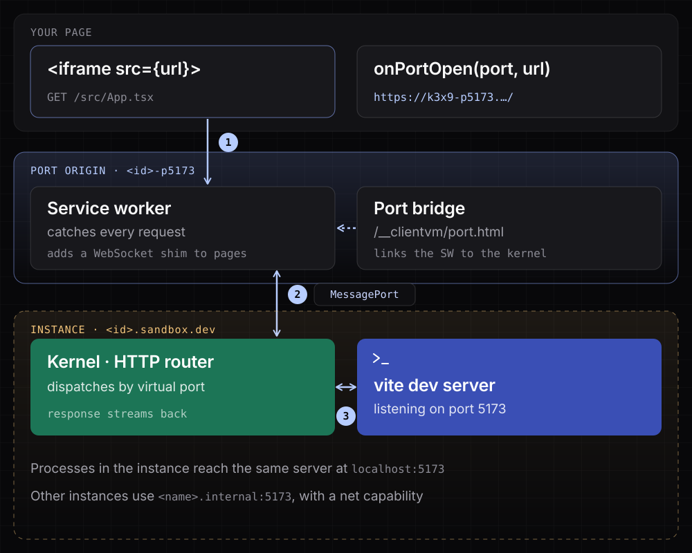

# How ClientVM works

ClientVM behaves like a small operating system that lives in a browser tab. This page follows
that system from the outside in: who runs where, how a blocking call works without a server, how
a dev server becomes a preview, and how instances stay apart. For a package-by-package tour see
[packages](packages.md); for the reasoning behind each choice see the
[design decisions](decisions.md).


## The pieces

| Piece | Where it runs | What it does |
|---|---|---|
| **Controller** (`@clientvm/clientvm`) | Your page, on your origin | Boots instances, checks every message they send, and brokers everything between them: capabilities, mailbox, forks, presets. It never runs agent code |
| **Instance page** (`@clientvm/sandbox-host`) | A hidden iframe on `https://<id>.<sandbox-domain>` | Cross-origin isolated by Document-Isolation-Policy. Registers the service worker, then starts the kernel |
| **Kernel worker** (`@clientvm/kernel`, `@clientvm/vfs`) | A dedicated worker under the instance page | Owns the instance: filesystem, process table, file descriptors, terminals, signals, virtual network, limits |
| **Process workers** (`@clientvm/process` + a runtime) | One nested worker per process | Run `node`, `sh`, `npm`, `vite` and your scripts, talking to the kernel through syscalls |
| **Service worker** (`@clientvm/sandbox-host`) | The instance origin and each port origin | Serves ES modules to processes and routes preview requests to virtual ports |

> [!NOTE]
> The **trust boundary** sits between the controller and the instance page. Everything on the
> sandbox side treats its input as hostile, and so does the controller towards the sandbox. See
> the [security model](security.md).

## Instances

An instance is the unit of isolation: one filesystem, one process table, one network namespace
and one budget. The controller creates it as a hidden iframe on its own subdomain, and the
browser's origin model does the isolating. Instances cannot see each other's storage, channels or
service workers, because they are different origins
([ADR 0003](decisions/0003-kernel-per-instance-origin.md)).

The handshake checks the exact window and origin on both sides. Then the controller and the kernel
talk over a single `MessagePort`: the kernel serves `InstanceRpc` (spawn, filesystem, snapshot,
grants), and calls back with `ControllerRpc` for things only the controller may do
(`mailboxSend`, `netFetch`). Crashed instances are detected by a heartbeat and torn down.

## Processes

Every process is a Web Worker, started by the kernel. The runtime it runs is chosen the way
Linux chooses a program: **commands are files**.

- Built-in runtimes are marker files in `/usr/local/bin` (`#!/clientvm/builtin node`).
- The kernel resolves `argv[0]` like `execve`: `PATH` lookup, exec bits, shebang interpreters.
  So `node_modules/.bin` symlinks and `#!/usr/bin/env node` scripts just work.
- Child processes go through the kernel. `spawnSync` is a syscall that blocks the caller until
  the child exits. Killing a process also kills its descendants, like a signal to a process
  group.

The shell is a runtime too. Its builtins and its ~60 Linux commands (`ls`, `grep`, `sed`, …) run
**inside the shell's worker**, so a loop over a thousand files costs microseconds per iteration,
not a worker spawn each time. Anything else (`node`, scripts, `.bin` shims) is spawned through the
kernel ([ADR 0011](decisions/0011-in-process-shell-commands.md)).

Processes can run on a **pseudo-terminal**: `isatty()` is true, Ctrl+C sends SIGINT to the
foreground job, raw mode works for full-screen programs, and resizes send SIGWINCH. Signals are
delivered to handlers, with a 1 s grace period before a stuck process is terminated
([ADR 0017](decisions/0017-pty-and-signals.md)).

## Synchronous syscalls

Node's synchronous APIs (`fs.readFileSync`, `execSync`, `require`) must block until the answer
arrives. Browsers do allow a worker to block, on a `SharedArrayBuffer` with `Atomics.wait`, but
only in a cross-origin isolated context. That is why the instance page needs its headers.


1. node-compat resolves the path against the process's working directory and encodes the
   arguments with a compact binary codec.
2. `SyscallClient.call(op, bytes)` writes a header and the payload into the process's channel,
   sets `STATE = REQUEST`, calls `Atomics.notify`, then blocks in `Atomics.wait`.
3. The kernel's `SyscallServer` wakes from `Atomics.waitAsync`
   ([ADR 0002](decisions/0002-syscall-wake-mechanism.md)), decodes the request and calls the
   filesystem.
4. It writes the response (or an `ERRNO`), sets `STATE = RESPONSE` and notifies.
5. The process copies the response out of shared memory and maps a non-zero errno to a
   Node-shaped `SystemError`.

Payloads larger than the 256 KiB channel are streamed in chunks, so the buffer never grows.
Handlers may return a Promise, which leaves room for slower backends; the blocked process doesn't
care how long the kernel takes.

<details>
<summary>The channel layout</summary>

| Int32 slot | Meaning |
|---|---|
| 0 `STATE` | 0 idle, 1 request posted, 2 response ready |
| 1 `OP` | syscall opcode (≥ 0) or channel opcode (< 0) |
| 2 `LEN` | payload bytes in this message |
| 3 `ERRNO` | positive errno on failure, else 0 |
| 4 `TOTAL` | total bytes of the request or response being streamed |
| 5–7 | reserved |

Then come `capacity` payload bytes. Large transfers use the channel opcodes `REQUEST_MORE` and
`RESPONSE_MORE`.

</details>

## The filesystem

Each instance has an in-memory filesystem with Linux semantics: inodes, symlinks, hard links,
file descriptors, quotas, watchers and copy-on-write snapshots. Syscalls never touch slower
storage. Instances created with `fs: { persist: true }` are written behind to the instance
origin's OPFS, debounced, crash-safe and content-addressed
([ADR 0004](decisions/0004-memory-first-vfs-opfs-persistence.md)).

## Loading modules

Processes load ES modules with the browser's native `import()` from `/__clientvm/fs/<path>`. The
service worker sends each request to the kernel's module server, which resolves specifiers with
Node's ESM algorithm (`exports`, `imports`, conditions), rewrites them to such URLs, and serves
CommonJS files as ES facades with the same named exports Node would detect. Live bindings, cycles
and top-level await therefore behave natively
([ADR 0006](decisions/0006-native-esm-via-service-worker.md)).

The instance page starts the kernel only once the service worker controls it, so every process
worker is controlled too.

## Servers and previews

Servers listen on **virtual ports** in the kernel's network stack. Inside the instance,
`http://localhost:5173/` reaches them. From your page, each port gets its own origin.



1. A process calls `listen(5173)`. The controller embeds a small bridge page on
   `https://<id>-p5173.<sandbox-domain>/`, which links that origin's service worker to the
   kernel, then reports the URL through `onPortOpen`.
2. Your page loads the URL in an iframe. The service worker forwards every request (except
   `/__clientvm/*`) to the kernel.
3. The kernel's HTTP router relays the request to the owning process as messages, and the
   response streams back as a transferred `ReadableStream`.

A port gets its own origin because dev servers emit absolute URLs (`/@vite/client`,
`/assets/x.js`) that would break under a path prefix, and because preview code should not share
an origin with the kernel ([ADR 0008](decisions/0008-sub-origin-per-port.md)). Service workers
cannot see WebSockets, so the service worker injects a small shim into HTML pages that carries
them to the server's `upgrade` handler.

## Many instances

Everything that crosses instances goes through the controller, and needs a **capability**
granted by the instance it concerns:

| Capability | Lets an instance… |
|---|---|
| `channel` | send mailbox messages to a peer |
| `net` | reach a peer's ports at `http://<name>.internal:<port>/` |
| `mount` | mount a peer's directory read-only |
| `spawn-instance` | create child instances and forks, within limits |

`fork()` exports the filesystem as an image, transfers it, and imports it on the new origin.
Snapshots inside one instance stay copy-on-write.

## How the packages depend on each other

```
protocol ◄── vfs ◄── kernel
   ▲
   ├──── process ◄── node-compat
   └──── (all)  ◄── sandbox-host (composes kernel + process + node-compat into worker entries)
clientvm (controller) ── protocol  (types + RpcEndpoint only; never bundles kernel code)
```

The process package does not depend on node-compat. Runtimes are injected as a `RuntimeTable` by
the worker entry in sandbox-host, which keeps process tiers (`js`, `builtin`, later `wasi`/`vm`)
pluggable.

## For contributors

- Sources import siblings with `.ts` extensions. `tsc` rewrites them to `.js`
  (`rewriteRelativeImportExtensions`), and Node 24 can run the sources directly through type
  stripping (`erasableSyntaxOnly`). This is how the channel tests run real worker threads.
- Each package's `exports` has a `@clientvm/source` condition pointing at `src/index.ts`. Vite and
  Vitest resolve it, so neither needs a prior build. Published consumers get `dist/`.
